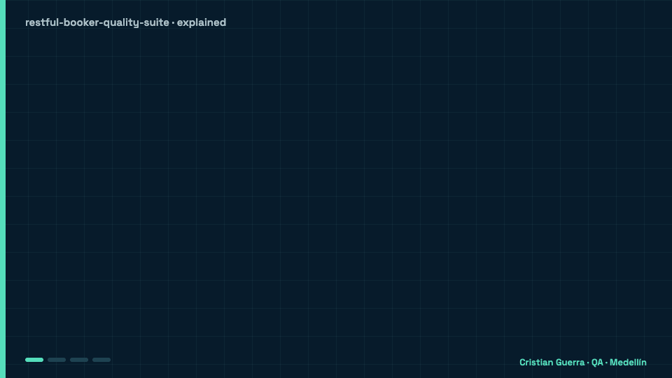

[Read in English](README.md)

<div align="center">


**Un framework de calidad de API con forma de producción, hecho con Playwright, TypeScript y Zod: automatización del ciclo de vida, validación estricta de contratos, pruebas negativas, presupuestos de rendimiento y reportes pensados para decidir un release.**

[](https://github.com/criguex/restful-booker-quality-suite/actions/workflows/tests.yml)
[](https://playwright.dev/)
[](https://www.typescriptlang.org/)
[](https://zod.dev/)
[](LICENSE)

</div>

---

## 🧒 Explicado para un niño de 8 años

Imagina un hotel donde un robot en la recepción toma las reservas de habitaciones. Este proyecto es
un equipo de huéspedes de mentiras: reservan una habitación, la cambian, la cancelan y revisan que
el hotel haya anotado todo bien. También miden qué tan rápido responde el hotel. Cuando el hotel se
equivoca, el error queda en una lista pegada en la pared para que nadie lo olvide. Y cada vez que
alguien cambia el código, un robot vuelve a correr todas las revisiones.

<p align="center">
  
</p>

### Un ejemplo real

- **Imagina** que reservas una habitación y dices "todavía **no** he pagado el depósito". Lo mandas
  en XML, una forma más vieja que usan los computadores para escribirse mensajes.
- **Qué pasa:** el hotel guarda "depósito pagado: **sí**". Tu _no_ se volvió un _sí_. Es el defecto
  RB-002 de [`docs/DEFECTS.md`](docs/DEFECTS.md).
- **Qué hace el proyecto:** una revisión compara lo que mandaste con lo que guardó el hotel y
  atrapa la diferencia. El bug se deja a propósito como _fallo esperado_: la corrida sigue en verde
  y, el día que el hotel lo arregle, la revisión se pone en rojo para avisar "quita esto de la
  lista".
- **Qué ganamos:** un hotel que cree que pagaste cuando no lo hiciste es un problema de plata. Ahora
  queda anotado, cualquiera lo repite con `npm run test:defects` y no se puede olvidar.

### Palabras difíciles

| Palabra              | Qué significa                                                                          |
| -------------------- | -------------------------------------------------------------------------------------- |
| **API**              | La ventanilla del hotel: los programas le piden cosas y ella responde.                 |
| **Prueba / chequeo** | Un programa pequeño que pregunta algo y compara la respuesta con la correcta.          |
| **Contrato (Zod)**   | La forma que debe tener una respuesta, como un formulario con cada casilla bien llena. |
| **CI**               | Un robot que corre todas las revisiones cada vez que alguien entrega un cambio.        |
| **Docker**           | Una caja que hace funcionar el hotel igualito en cualquier computador.                 |
| **Fallo esperado**   | Un bug conocido que se deja a propósito para que siga visible hasta que lo arreglen.   |
| **p95**              | De cada 100 respuestas, 95 llegan más rápido que este tiempo.                          |

## 🎯 Qué demuestra este proyecto

Este repositorio trata la demo de Restful Booker como un release pequeño, no como una
colección de scripts sueltos. Verifica el ciclo de vida completo de una reserva, los
límites de autenticación y autorización, los contratos de respuesta, la compatibilidad,
la preservación de los datos y los presupuestos de latencia. Cada prueba es dueña de sus
datos y los limpia aunque una aserción falle.

> **43 chequeos automatizados en cuatro gates de calidad independientes.** Ocho defectos
> confirmados están codificados como fallos esperados, así siguen visibles sin esconder
> regresiones que no tengan que ver con ellos.

## 🗂️ Gates de calidad

| Proyecto          | Propósito                                                 | Ejemplos                                                                | Comando                    |
| ----------------- | --------------------------------------------------------- | ----------------------------------------------------------------------- | -------------------------- |
| **`api`**         | Cobertura funcional, de integración y negativa            | CRUD, filtros, métodos de autenticación, Unicode, mutaciones prohibidas | `npm run test:api`         |
| **`contract`**    | Validación estricta de la forma de las respuestas con Zod | Esquemas de reserva, lista de IDs, creación y autenticación             | `npm run test:contract`    |
| **`component`**   | Validación aislada de esquemas y límites                  | Fechas, tipos, precios, nombres e identificadores de creación           | `npm run test:component`   |
| **`performance`** | Presupuestos livianos contra regresiones                  | p95 del health check y latencia de la lista de reservas                 | `npm run test:performance` |

## ✅ Cobertura y trazabilidad

| Capacidad / riesgo          | Evidencia automatizada                                              | Prioridad |
| --------------------------- | ------------------------------------------------------------------- | --------: |
| Disponibilidad del servicio | Estado y cuerpo de `/ping`                                          |        P0 |
| Autenticación               | Forma del token válido y credenciales inválidas                     |        P0 |
| Autorización                | Cookie, Basic auth, token inválido y credenciales ausentes          |        P0 |
| Ciclo de vida de la reserva | Crear → consultar → PUT/PATCH → borrar → verificar que ya no existe |        P0 |
| Integridad de datos         | Campos omitidos en PATCH, valores en cero, datos opcionales vacíos  |        P0 |
| Búsqueda                    | El filtro por nombre/apellido devuelve el registro propio           |        P1 |
| Compatibilidad              | JSON, XML y tipos de contenido no soportados                        |        P1 |
| Datos internacionales       | Tildes, espacios, apóstrofos y Unicode                              |        P1 |
| Contratos de API            | Esquemas Zod estrictos para cada respuesta principal                |        P1 |
| Rendimiento                 | p95 repetible y presupuestos por endpoint                           |        P2 |

La priorización completa y las decisiones de release están en
[`docs/TEST_STRATEGY.md`](docs/TEST_STRATEGY.md). Los hallazgos confirmados están en
[`docs/DEFECTS.md`](docs/DEFECTS.md). El resultado verificado de la demo está resumido
en [`docs/EXECUTION_REPORT.md`](docs/EXECUTION_REPORT.md). Estos documentos están en inglés.

## 🔄 Cómo funciona


<p align="center">
  
</p>

La animación repite la corrida verificada del 16 de octubre de 2026 que está en
[`docs/EXECUTION_REPORT.md`](docs/EXECUTION_REPORT.md); se genera desde
[`docs/scenes/how-it-works.html`](docs/scenes/how-it-works.html) con
[`docs/scenes/export.sh`](docs/scenes/export.sh) (también en
[`how-it-works.mp4`](docs/assets/how-it-works.mp4)). Hay un short vertical hecho con Remotion en
[`restful-booker-quality-short.mp4`](docs/assets/restful-booker-quality-short.mp4), con su fuente en
[`showcase/`](showcase). El flujo ampliado, el modelo de propiedad de los datos y los caminos de
falla están en [`docs/TEST_FLOW.md`](docs/TEST_FLOW.md).

## ✨ Puntos de ingeniería

- **Propiedad determinista de los datos** — registros únicos por prueba y limpieza en `finally`.
- **Aserciones guiadas por contrato** — los esquemas Zod fallan mostrando campo por campo qué cambió.
- **Varios caminos de autenticación** — se ejercitan tanto el token por cookie como Basic auth.
- **Manejo honesto de los defectos conocidos** — el fallo esperado se vuelve un pase inesperado cuando lo arreglan.
- **Diseño seguro en paralelo** — no depende de IDs sembrados ni del orden de ejecución.
- **Cuatro gates en CI** — lo funcional, los contratos, los componentes y el rendimiento se ven por separado.
- **Artefactos de falla** — el reporte HTML, con las trazas de las pruebas que fallan, se sube desde el CI; el JUnit XML queda en `test-results/`.
- **Sistema bajo prueba fijado** — el CI descarga una revisión conocida y la construye en Docker.
- **Calidad estática** — ESLint, Prettier y TypeScript estricto corren antes de las suites.

## 📁 Estructura

```text
restful-booker-quality-suite/
├── src/
│   ├── contracts/bookingSchemas.ts  # Fuente de verdad en Zod
│   └── support/expectSchema.ts       # Aserción de contrato legible
├── tests/
│   ├── api/                          # Funcional + integración + negativas
│   ├── contract/                     # Contratos estrictos de respuesta
│   ├── component/                    # Componentes aislados de contrato/esquema
│   └── performance/                  # Presupuestos de latencia de la API
├── docs/
│   ├── TEST_STRATEGY.md              # Modelo de riesgo y política de release
│   ├── TEST_FLOW.md                  # Diagramas de ejecución y de caminos de falla
│   ├── assets/                       # Banner, diagrama, GIF/MP4 y short vertical
│   ├── scenes/                       # Fuentes y script de exportación de los GIF
│   └── DEFECTS.md                    # Hallazgos confirmados y reproducibles
├── showcase/                         # Fuente en Remotion del short vertical
├── .github/workflows/tests.yml       # Pipeline de CI con Docker
├── playwright.config.ts              # Cuatro proyectos de Playwright
└── CONTRIBUTING.md                   # Política de contribución de calidad
```

## 🚀 Correrlo en local

### 1. Levantar el sistema bajo prueba

```bash
git clone https://github.com/mwinteringham/restful-booker.git
git clone https://github.com/criguex/restful-booker-quality-suite.git
docker compose -f restful-booker/docker-compose.yml -f restful-booker-quality-suite/compose.loopback.yml up --build -d
cd restful-booker-quality-suite
```

El sistema debería responder en `http://127.0.0.1:3001`. [`compose.loopback.yml`](compose.loopback.yml) publica el puerto solo en `127.0.0.1`; el `docker-compose.yml` original, solo, lo publica en todas las interfaces.

### 2. Instalar y ejecutar

```bash
npm ci
npm run quality
```

Apuntar a otro ambiente sin cambiar código:

```bash
API_BASE_URL=https://example.test npm test
```

## 🧰 Comandos

| Comando                    | Para qué sirve                               |
| -------------------------- | -------------------------------------------- |
| `npm test`                 | Corre todos los proyectos de Playwright      |
| `npm run test:smoke`       | Retroalimentación rápida de P0               |
| `npm run test:api`         | Suite funcional/de integración               |
| `npm run test:contract`    | Contratos estrictos con Zod                  |
| `npm run test:component`   | Chequeos aislados de los esquemas            |
| `npm run test:performance` | Presupuestos de latencia                     |
| `npm run test:negative`    | Caminos negativos y de autorización          |
| `npm run test:defects`     | Reproduce cada defecto confirmado            |
| `npm run quality`          | Formato, lint, typecheck y todas las pruebas |
| `npm run report`           | Abre el reporte HTML local                   |

## 🐞 Hallazgos confirmados

Ocho defectos reproducibles cubren la negociación de contenido, la corrupción de booleanos en
XML, la pérdida de precisión en valores monetarios, las fechas inválidas, los códigos de estado
para recursos inexistentes, el manejo de payloads inválidos y la semántica de la autenticación
fallida. Ver [`docs/DEFECTS.md`](docs/DEFECTS.md) o el reporte portable
[`docs/DEFECTS.html`](docs/DEFECTS.html).

## 🔁 Comportamiento del CI

En cada push y pull request, GitHub Actions:

1. Clona el sistema bajo prueba en una revisión fijada.
2. Lo construye y lo levanta con Docker Compose.
3. Espera a que el health check responda bien.
4. Corre los chequeos de formato, lint y TypeScript estricto.
5. Ejecuta los cuatro proyectos de Playwright.
6. Sube los reportes e imprime los logs del sistema si algo falla.

## 👤 Autor

**Cristian Guerra** — Senior QA Automation Engineer · Medellín, Colombia

[GitHub](https://github.com/criguex)

## 📄 Licencia

[MIT](LICENSE)
