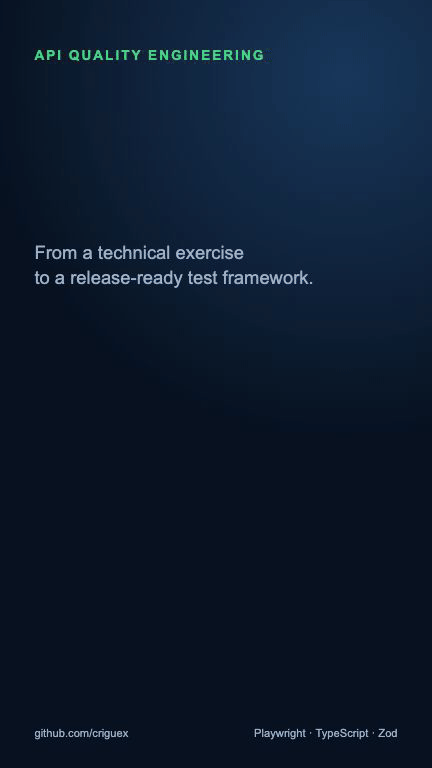
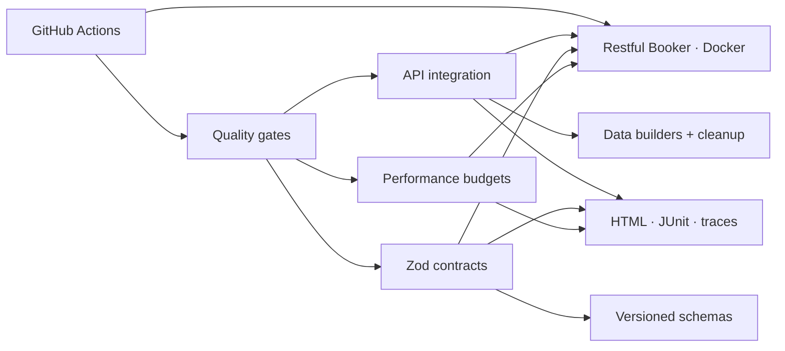
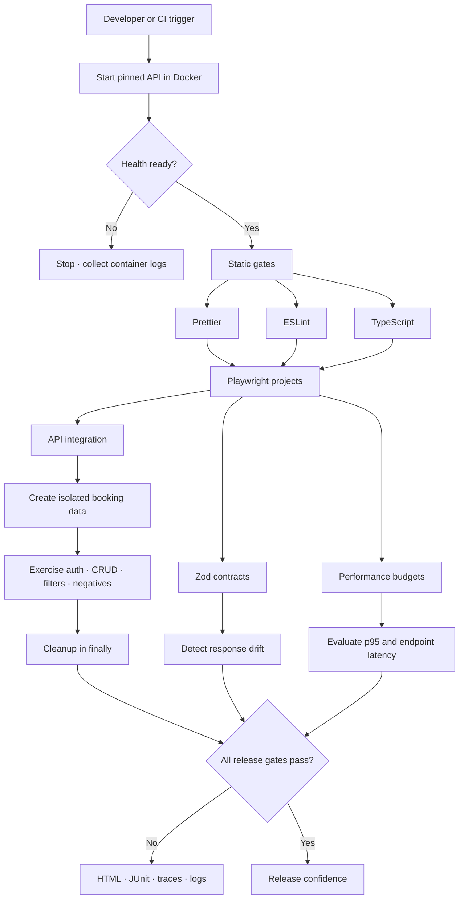

<div align="center">

# 🏨 Restful Booker — API Quality Engineering

**A production-shaped API quality framework built with Playwright, TypeScript and Zod — combining lifecycle automation, strict contract validation, negative testing, performance budgets and release-focused reporting.**

[](https://github.com/criguex/restful-booker-quality-suite/actions/workflows/tests.yml)
[](https://playwright.dev/)
[](https://www.typescriptlang.org/)
[](https://zod.dev/)
[](LICENSE)

</div>

---

## 🎯 What this project proves

This repository treats the Restful Booker challenge as a small release, not as a
collection of isolated scripts. It verifies the complete booking lifecycle,
authentication and authorization boundaries, response contracts, compatibility,
data preservation and latency budgets. Tests own their data and clean it even when
an assertion fails.

> **43 automated checks across four independent quality gates.** Eight confirmed
> defects are encoded as expected failures so they remain visible without hiding
> unrelated regressions.

## 🗂️ Quality gates

| Project           | Purpose                                       | Examples                                                  | Command                    |
| ----------------- | --------------------------------------------- | --------------------------------------------------------- | -------------------------- |
| **`api`**         | Functional, integration and negative coverage | CRUD, filters, auth methods, Unicode, forbidden mutations | `npm run test:api`         |
| **`contract`**    | Strict response-shape validation with Zod     | Booking, ID list, creation and authentication schemas     | `npm run test:contract`    |
| **`component`**   | Isolated schema and boundary validation       | Dates, types, prices, names and creation identifiers      | `npm run test:component`   |
| **`performance`** | Lightweight regression budgets                | Health p95 and booking-list latency                       | `npm run test:performance` |

## ✅ Coverage and traceability

| Capability / risk    | Automated evidence                                        | Priority |
| -------------------- | --------------------------------------------------------- | -------: |
| Service availability | `/ping` status and body                                   |       P0 |
| Authentication       | Valid token shape and invalid credentials                 |       P0 |
| Authorization        | Cookie, Basic auth, invalid token and missing credentials |       P0 |
| Booking lifecycle    | Create → retrieve → PUT/PATCH → delete → verify absence   |       P0 |
| Data integrity       | Omitted PATCH fields, zero values, empty optional data    |       P0 |
| Search               | First/last-name filter returns the owned record           |       P1 |
| Compatibility        | JSON, XML and unsupported media types                     |       P1 |
| International data   | Accents, whitespace, apostrophes and Unicode              |       P1 |
| API contracts        | Strict Zod schemas for every core response                |       P1 |
| Performance          | Repeatable p95 and endpoint budgets                       |       P2 |

Full prioritization and release decisions live in
[`docs/TEST_STRATEGY.md`](docs/TEST_STRATEGY.md). Confirmed findings are in
[`docs/DEFECTS.md`](docs/DEFECTS.md). The verified assessment outcome is summarized
in [`docs/EXECUTION_REPORT.md`](docs/EXECUTION_REPORT.md).

## 🎬 Visual walkthrough

<p align="center">
  
</p>

Download the full-resolution vertical short:
[`restful-booker-quality-short.mp4`](docs/assets/restful-booker-quality-short.mp4).

## ✨ Engineering highlights

- **Deterministic test ownership** — unique records per test and cleanup in `finally`.
- **Contract-first assertions** — Zod schemas fail with readable field-level drift.
- **Multiple auth paths** — token cookie and Basic authentication are both exercised.
- **Honest known-defect handling** — expected failure becomes an unexpected pass when fixed.
- **Parallel-safe API design** — no dependency on seeded IDs or test execution order.
- **Four CI gates** — functional, contract, component and performance concerns stay independently visible.
- **Failure artifacts** — HTML, JUnit and Playwright traces are uploaded from CI.
- **Pinned system under test** — CI checks out a known revision and builds it in Docker.
- **Static quality** — ESLint, Prettier and strict TypeScript run before the suites.

## 🏗️ Architecture



## 🔄 Test execution flow



The expanded flow, ownership model and failure paths are documented in
[`docs/TEST_FLOW.md`](docs/TEST_FLOW.md).

## 📁 Structure

```text
restful-booker-quality-suite/
├── src/
│   ├── contracts/bookingSchemas.ts  # Zod source of truth
│   └── support/expectSchema.ts       # Readable contract assertion
├── tests/
│   ├── api/                          # Functional + integration + negative
│   ├── contract/                     # Strict response contracts
│   ├── component/                    # Isolated contract/schema components
│   └── performance/                  # API latency budgets
├── docs/
│   ├── TEST_STRATEGY.md              # Risk model and release policy
│   ├── TEST_FLOW.md                  # Execution and failure-flow diagrams
│   ├── assets/                       # GIF and full-resolution short
│   └── DEFECTS.md                    # Reproducible confirmed findings
├── showcase/                         # Remotion source for visual walkthrough
├── .github/workflows/tests.yml       # Docker-backed CI pipeline
├── playwright.config.ts              # Four Playwright projects
└── CONTRIBUTING.md                   # Quality contribution policy
```

## 🚀 Run locally

### 1. Start the system under test

```bash
git clone https://github.com/mwinteringham/restful-booker.git
cd restful-booker
docker compose up --build -d
```

The target should answer at `http://127.0.0.1:3001`.

### 2. Install and execute

```bash
npm ci
npm run quality
```

Target another environment without changing code:

```bash
API_BASE_URL=https://example.test npm test
```

## 🧰 Commands

| Command                    | Purpose                               |
| -------------------------- | ------------------------------------- |
| `npm test`                 | Run every Playwright project          |
| `npm run test:smoke`       | Fast P0 feedback                      |
| `npm run test:api`         | Functional/integration suite          |
| `npm run test:contract`    | Strict Zod contracts                  |
| `npm run test:component`   | Isolated schema component checks      |
| `npm run test:performance` | Latency budgets                       |
| `npm run test:negative`    | Negative and authorization paths      |
| `npm run test:defects`     | Reproduce every confirmed defect      |
| `npm run quality`          | Format, lint, typecheck and all tests |
| `npm run report`           | Open the local HTML report            |

## 🐞 Confirmed findings

Eight reproducible defects cover content negotiation, XML boolean corruption, monetary
precision loss, invalid dates, missing-resource status codes, invalid payload handling
and failed-authentication semantics. See [`docs/DEFECTS.md`](docs/DEFECTS.md) or the
portable [`docs/DEFECTS.html`](docs/DEFECTS.html) report.

## 🔁 CI behavior

For every push and pull request, GitHub Actions:

1. Clones the pinned system under test.
2. Builds and starts it with Docker Compose.
3. Waits for a successful health check.
4. Runs formatting, linting and strict TypeScript checks.
5. Executes all four Playwright projects.
6. Uploads reports and prints target logs on failure.

## 👤 Author

**Cristian Guerra** — Senior QA Automation Engineer

[GitHub](https://github.com/criguex)

## 📄 License

[MIT](LICENSE)
