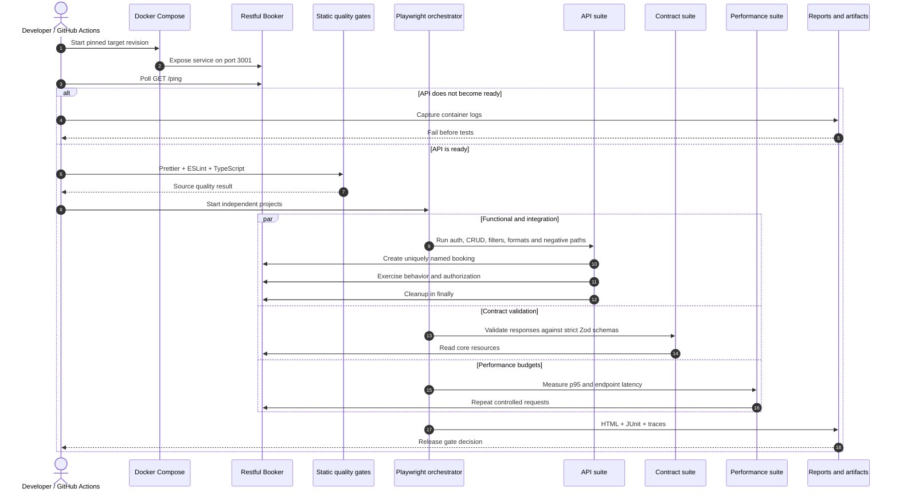

# Test execution flow

## Failure handling

- Service-start failure stops execution and prints target logs.
- Functional failures retain a Playwright trace and owned data is still cleaned.
- Contract drift reports the exact invalid field instead of weakening the schema.
- RB-001 remains an expected failure until the product fixes its XML content type.
- CI uploads the HTML report regardless of test outcome.
